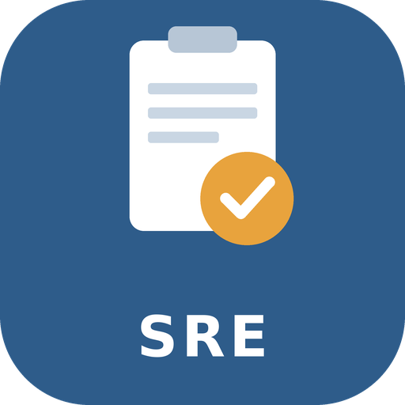

# mi_app
<p align="center">
  
</p>

# Sistema de Reportes Escolares

Aplicación móvil desarrollada con **Flutter** para registrar, consultar y dar seguimiento a reportes de incidencias dentro de una escuela, como computadoras dañadas, fallas de internet, salones en mal estado, problemas eléctricos, mobiliario dañado o problemas de limpieza.

Proyecto realizado para la materia **Desarrollo de Aplicaciones Móviles** en la **Universidad Politécnica de la Región Ribereña**.

## Objetivo

Crear una aplicación móvil que permita a los alumnos y al personal reportar problemas del plantel, y a un administrador revisarlos, cambiar su estado y darles seguimiento hasta su resolución.

## Tipos de usuarios

| Rol | Funciones |
|---|---|
| **Alumno / Usuario** | Registrarse e iniciar sesión, crear un reporte, adjuntar una fotografía, seleccionar una categoría, consultar sus reportes y ver el estado de cada uno |
| **Administrador** | Ver todos los reportes, consultar detalles, cambiar el estado, agregar comentarios, eliminar reportes y consultar los reportes resueltos |

## Estados de un reporte

```
PENDIENTE → EN REVISIÓN → EN PROCESO → RESUELTO
```

Opcionalmente, un reporte puede quedar como **CANCELADO**.

## Estructura de pantallas

```
LOGIN
 ├── USUARIO → Dashboard → Crear reporte / Mis reportes / Perfil
 └── ADMINISTRADOR → Dashboard → Todos los reportes / Estadísticas → Detalles → Cambiar estado
```

## Estado actual del proyecto

La versión actual es un prototipo con pantallas de práctica, organizadas en tres pestañas:

- **Hola:** logo de la app con animación automática, campo de nombre con casilla y un botón **Ver frase** que abre una página nueva.
- **Contador:** fondo degradado de arcoíris, campo de texto y botón que agranda el texto en cada clic.
- **Cupertino:** pantalla con widgets estilo iOS (`CupertinoTextField`, `CupertinoButton`), una alerta (`CupertinoAlertDialog`) y un `Stack` con elementos en capas.

## Tecnologías

- [Flutter](https://flutter.dev) y Dart
- Material 3 y widgets Cupertino
- Visual Studio Code
- Git y GitHub

## Estructura del proyecto

```
├── lib/
│   └── main.dart          # Código principal de la app
├── assets/
│   └── images/
│       └── logo_sre.png   # Logo de la aplicación
├── android/               # Proyecto Android
├── web/                   # Proyecto web
└── pubspec.yaml           # Dependencias y recursos
```

## Cómo ejecutarlo

1. Instala el [Flutter SDK](https://docs.flutter.dev/get-started/install) y verifica tu instalación con `flutter doctor`.
2. Clona el repositorio y entra a la carpeta del proyecto:

```bash
   git clone <URL-DE-TU-REPOSITORIO>
   cd sistema_reportes_escolares
```

3. Descarga las dependencias:

```bash
   flutter pub get
```

4. Ejecuta la app en el dispositivo que prefieras:

```bash
   flutter run
```

   Para correrla en Chrome: `flutter run -d chrome`

## Autor

- **Alumno:** Tomás de Jesús Castán Baltazar
- **Docente:** ING. Jonathan Elí Sáenz Meléndez
- **Grupo:** ITIID2501, cuarto cuatrimestre
- **Universidad:** Universidad Politécnica de la Región Ribereña
